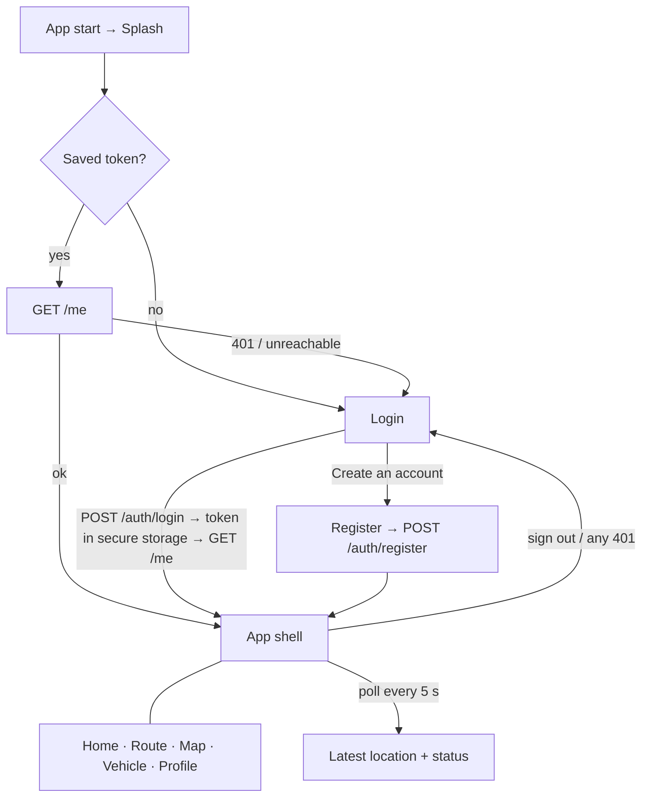

# Bus Tracker – Flutter App

Mobile client for the **GPS Vehicle Tracking FastAPI backend** (companion repo: `gps-tracking-backend`). A user signs in and sees *their* assigned route, *their* assigned vehicle, its live GPS position and status, and a map where the bus glides along the route in real time.

The app contains no assignment logic. It only calls the `/api/v1/me/*` endpoints; **the backend decides** which route and vehicle belong to the logged-in user (and returns 403 for anything else), so a modified client cannot see someone else's bus.

## Setup

Prerequisites: Flutter 3.22+ (Dart 3.3+), the backend running (`docker compose up --build` in the backend repo).

```bash
git clone <this repo> && cd gps-tracker-app
./tool/setup_platforms.sh      # one time: generates android/ ios/, adds permissions, runs pub get
flutter run --dart-define=API_BASE_URL=http://10.0.2.2:8000
```

On Windows PowerShell (no bash) run `flutter create --org com.example --project-name gps_tracker_app --platforms=android,ios .` and delete `test/widget_test.dart`; for Chrome use `flutter create --platforms=web .`.

`API_BASE_URL` (backend root, no `/api/v1`) depends on where the app runs; you can also change the default in `lib/core/config.dart`:

| Target | Value |
|---|---|
| Android emulator | `http://10.0.2.2:8000` (default) |
| iOS simulator / Chrome / Windows | `http://localhost:8000` |
| Physical phone (same Wi-Fi) | `http://<your-computer-LAN-IP>:8000` |
| Deployed backend | `https://api.example.com` |

The setup script enables plain HTTP for local development only (Android `usesCleartextTraffic`, iOS `NSAllowsLocalNetworking`). Use HTTPS in production and remove those flags.

Demo logins (seeded by the backend; its simulator makes the buses move):

| Email | Password | Sees |
|---|---|---|
| alice@example.com | password123 | Route A · BUS-001 |
| bob@example.com | password123 | Route B · BUS-002 |
| carol@example.com | password123 | Route A · BUS-003 |

New accounts created with *Create an account* have no assignment until an admin sets it (`PUT /api/v1/admin/users/{id}/assignment`; admin login `admin@example.com` / `admin12345`, e.g. via `/docs` → Authorize).

Tests: `flutter test`

If the bus shows **Offline**: that means no GPS fix in the last 60 s. Keep the simulator running (`python -m simulator.simulator --rest http://localhost:8001` in the backend repo, or Docker Compose) or a device publishing.

## Two apps, one codebase

| App | Entry point | Who | Run |
|---|---|---|---|
| **Bus Tracker** (riders) | `lib/main.dart` | passengers: see *their* route and bus | `flutter run` |
| **Admin Console** | `lib/main_admin.dart` | administrators (`is_admin = true`) | `flutter run -t lib/main_admin.dart` |

```bash
# rider app in Chrome
flutter run -d chrome --dart-define=API_BASE_URL=http://localhost:8001
# admin console in Chrome (best on a wide screen) - sign in with admin@example.com / admin12345
flutter run -d chrome -t lib/main_admin.dart --dart-define=API_BASE_URL=http://localhost:8001
# release builds
flutter build web -t lib/main_admin.dart
flutter build apk -t lib/main_admin.dart
```

The admin app refuses non-administrator accounts and keeps its session under a different storage key, so both can be used on the same device. (To install both APKs on one Android phone, give the admin build its own `applicationId` / flavor.)

**Admin Console features** (all backed by `/api/v1/admin/*`, which the server restricts to admins):

* **Fleet** - live counts (moving / idle / offline / no signal / users / unassigned), one map with every route and every bus (tap a bus for details and recent GPS fixes), vehicle list; refreshes every 5 s.
* **Users** - search, create users, edit name, activate/deactivate, grant admin, reset password, and assign or clear a route + vehicle (the vehicle list is filtered by the chosen route).
* **Vehicles** - add vehicles (the code is the ID the GPS device sends), change plate/route, activate/deactivate (inactive vehicles stop accepting GPS data).
* **Routes** - draw a route by tapping the map to add stops, rename stops, drag to reorder, save; delete unused routes.

Layout: dark side rail on screens >= 900 px, bottom bar on phones.

## Design

Warm "desert sunset" look: sand canvas, cream neumorphic cards, terracotta gradients and a charcoal dark card; the logo's sky-blue and pink appear only as small accents (route pins, alerts). Every screen has its own layout:

| Screen | Design idea | Live / touch animation |
|---|---|---|
| **Splash** | Terracotta dusk scene, logo in a cream badge | Logo springs in, hills drift, road dashes scroll, title fades up |
| **Login** | Animated road scene on top, form on a cream sheet sliding over it | Bus rumbles on the road, staggered field entrance, scene shrinks when the keyboard opens |
| **Register** | A *boarding pass*: terracotta header with barcode, perforation line, side notches | Pass slides up, fields cascade in, button morphs to a spinner |
| **Home** | Greeting + dark "weather-style" live card (speed, status, last 5 speeds), BUS PASS ticket with tear-off stub, map card, "bus is near" / "last update" cards, top stops | Speed counts up, rotating rays behind the bus, bars grow, "5s ago" ticks every second, cards stagger in |
| **Route** | Vertical timeline; travelled part fills terracotta, pulsing bus badge on the nearest stop | Rows cascade, line segments recolour as the bus advances |
| **Map** | Edge-to-edge warm-tinted map with frosted-glass cards | Bus marker glides between GPS fixes, rotates to its heading and pulses; follow / fit-route buttons |
| **Vehicle** | Dark header with number plate, big speedometer overlapping it, telemetry tiles, speed history | Gauge sweeps to the new speed, bars spring up |
| **Profile** | Terracotta header with pulsing avatar, detail rows, confirmed sign-out | Rows cascade in |

Touch feedback: every card, button and nav item squishes on press and springs back (`Pressable`) with a light haptic tick; the refresh button spins; the bottom bar animates its selected icon, label and indicator, and the centre "Live map" button pulses; tabs cross-fade.

Logo: `assets/images/logo.png` (background removed) and `bus.png` (bus-only sprite for the animated scenes). Replace those files to rebrand; the palette lives in `lib/theme/app_theme.dart`.

## Screens & flow



## Architecture

```
lib/
  main.dart                 rider app + AuthGate (Splash → Login → App, cross-faded)
  main_admin.dart           Admin Console entry point
  theme/app_theme.dart      palette, gradients, shadows, ThemeData
  core/                     config, api_client (Dio), api_exception, token_storage, format, geo
  models/models.dart        AppUser, RouteInfo, Stop, Vehicle, VehicleLocation
  providers/                admin_provider, auth_provider, tracking_provider (route, vehicle, polling, speed samples), nav_controller
  screens/                  splash, login, register, shell + home/route/map/vehicle/profile pages
  screens/admin/            admin login, shell, fleet overview, users, vehicles, routes (+ map route editor)
  widgets/                  pressable, animations, buttons, neu_card, ticket, bottom_nav,
                            tracking_map (animated), painters, status_chip, error_view, data_gate, logo
```

State management is `provider` + `ChangeNotifier`.

* **Session handling.** The JWT is stored in secure storage and attached by a Dio interceptor. Any `401` from a protected call returns the user to login, even if another page is open. A 401 from the login call itself just means wrong credentials.
* **Per-session tracking state.** `TrackingProvider` is created inside the signed-in branch, keyed by user id. Logging out disposes it (cancelling polling); a different user always starts clean.
* **Live updates.** One 5-second polling loop (`locationPollInterval`) refreshes location + vehicle status for all tabs. The map interpolates the bus between fixes, so movement looks continuous even though data arrives every few seconds.
* **Unassigned users** can still open the Profile tab (and sign out); the other tabs explain that an admin must assign a route and vehicle.

## Error handling & loading states

| Situation | Behaviour |
|---|---|
| Signing in / registering | Button morphs to a spinner, fields disabled |
| First load | Animated logo + progress bar ("Finding your bus…") |
| Route/vehicle can't be loaded (network, 404 "nothing assigned", 5xx) | Friendly message with **Try again** |
| A live refresh fails after data was loaded | "Live updates paused" banner, last position stays, polling keeps retrying |
| Vehicle never reported | "Waiting for signal" status + hint on the map |
| Timeout / no connection | Distinct messages for "can't reach server" and "took too long" |
| Token expired | Back to login with "Your session expired" |

## Backend endpoints used

`POST /api/v1/auth/register` · `POST /api/v1/auth/login` · `GET /api/v1/me` · `GET /api/v1/me/route` · `GET /api/v1/me/vehicle` · `GET /api/v1/me/vehicle/location`
