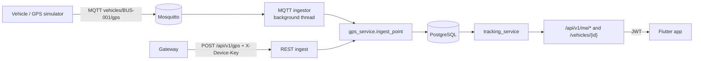
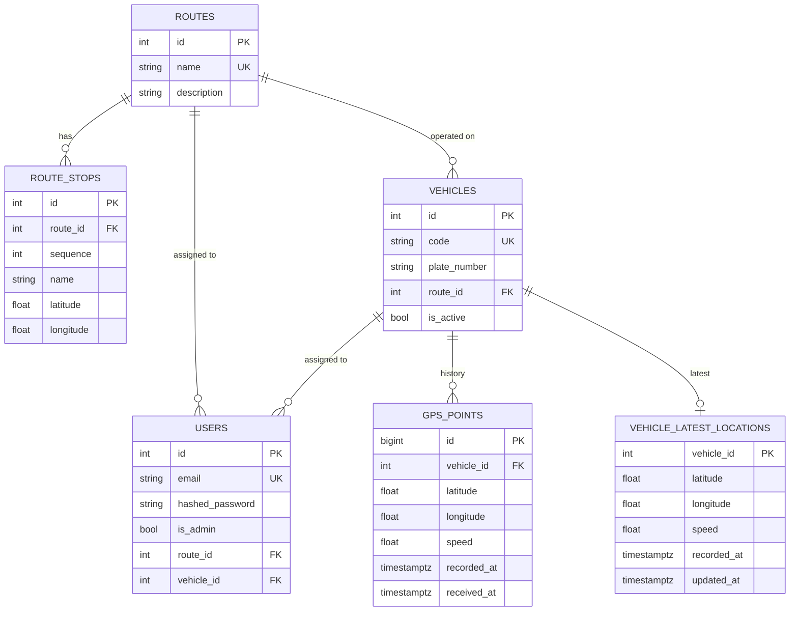

# GPS Vehicle Tracking – FastAPI Backend

Receives GPS fixes from vehicles (MQTT preferred, REST fallback), stores the **latest location** and the **full history** per vehicle in PostgreSQL, and exposes an authenticated API where every user can see **only their own assigned route and vehicle**. The assignment is enforced on the server, not in the mobile app.

Companion repo: **gps-tracker-app** (Flutter client).

## Quick start (Docker – everything in one command)

```bash
docker compose up --build
```

Starts PostgreSQL, a Mosquitto MQTT broker, the API (http://localhost:8000/docs), and a **GPS simulator** that drives BUS-001/002/003 along their routes. Demo data is seeded automatically.

| User | Password | Route | Vehicle |
|---|---|---|---|
| alice@example.com | password123 | Route A | BUS-001 |
| bob@example.com | password123 | Route B | BUS-002 |
| carol@example.com | password123 | Route A | BUS-003 |
| admin@example.com | admin12345 | – (administrator) | – |

Try it:
```bash
TOKEN=$(curl -s -X POST localhost:8000/api/v1/auth/login -H 'content-type: application/json' \
  -d '{"email":"alice@example.com","password":"password123"}' | python3 -c 'import sys,json;print(json.load(sys.stdin)["access_token"])')
curl -H "Authorization: Bearer $TOKEN" localhost:8000/api/v1/me/vehicle/location
```

**Why does a bus show "Offline"?** Status is computed from the newest GPS fix: no fix for 60 s (`ONLINE_THRESHOLD_SECONDS`) = *offline*, never reported = *no signal*. Something must keep sending data: the simulator (Docker starts it for you), a device, or the `--rest` simulator below.

### Run without Docker
```bash
python -m venv .venv && source .venv/bin/activate && pip install -r requirements.txt
cp .env.example .env            # point DATABASE_URL at your Postgres, MQTT_HOST at your broker
uvicorn app.main:app --reload   # tables are created and demo data seeded on startup
python -m simulator.simulator --host localhost --interval 2   # optional GPS simulator (needs an MQTT broker)
python -m simulator.simulator --rest http://localhost:8000    # ...or, with no broker, post fixes over REST
pytest                          # tests use SQLite, no broker required
```

## Architecture



```
app/
  main.py              app factory, lifespan (create tables, seed, start MQTT)
  core/                settings (env-driven), JWT + bcrypt
  db/                  engine/session, base + UTC type, idempotent seed
  models/              SQLAlchemy 2.0 models
  schemas/             Pydantic request/response models
  services/            business logic: gps_service (ingest), tracking_service (reads),
                       assignment (route/vehicle rule), mqtt_client (subscriber)
  api/deps.py          authentication + authorization dependencies
  api/routes/          auth, me, resources, gps (thin HTTP layer only)
simulator/             MQTT GPS simulator
data/seed.json         demo routes, vehicles, users (shared by seed + simulator)
tests/                 end-to-end tests of the business logic
```

Routers contain no business logic; services have no HTTP knowledge, so ingestion from MQTT and REST share exactly the same code path.

## Database design



* **users** carry the assignment (`route_id`, `vehicle_id`) – one route and one vehicle per user. Several users may share a route (and even a bus); a vehicle always belongs to exactly one route.
* **gps_points** is append-only history. `UNIQUE(vehicle_id, recorded_at)` makes redelivered MQTT messages idempotent; `INDEX(vehicle_id, recorded_at)` serves history queries.
* **vehicle_latest_locations** has one row per vehicle so "where is my bus?" is a primary-key lookup instead of a scan over history.
* Timestamps are stored as UTC `timestamptz`; `recorded_at` is device time, `received_at` is server time.

## Authentication

* `POST /api/v1/auth/register` (`full_name`, `email`, `password` 8–72 chars) creates an account and returns a token, so the app can sign the user straight in. Emails are lower-cased; a duplicate returns **409**. A new account has **no route or vehicle**, so it sees nothing (`404 No route assigned`) until an administrator assigns one. Self-registration therefore never grants access to any bus.
* `POST /api/v1/auth/login` with email + password → short-lived **JWT** (HS256, `sub` = user id, default 60 min).
* Passwords are hashed with **bcrypt**. Login returns the same 401 for unknown email / wrong password / inactive user and always performs one bcrypt comparison, so neither the message nor timing reveals which emails exist.
* Every other endpoint requires `Authorization: Bearer <token>`; the user is re-loaded from the DB on each request, so deactivating a user takes effect immediately.

## Route / vehicle assignment & authorization

0. Assignments are made by an administrator: `PUT /api/v1/admin/users/{id}/assignment` with `{route_id, vehicle_id}` (admin-only, 403 otherwise). Seeded demo users are pre-assigned from `data/seed.json`.
1. `services/assignment.assign_user` is the only place an assignment is made, and it rejects a vehicle that doesn't run the given route.
2. **`/api/v1/me/*` endpoints take no id.** The route/vehicle is resolved from the *authenticated user's* row, so there is nothing a client can tamper with.
3. The id-based endpoints (`/vehicles/{id}…`, `/routes/{id}`) pass through `authorize_vehicle` / `authorize_route`, which return **403** unless the id equals the caller's own assignment. Non-existent ids also return 403, so ids cannot be enumerated.
4. Example: Alice (Route A / BUS-001) calling `GET /vehicles/<BUS-002's id>/location` → `403`. Covered by `tests/test_flow.py::test_cross_user_access_is_forbidden_by_the_backend`.

## GPS data flow

**MQTT (primary).** Topic `vehicles/<VEHICLE_CODE>/gps`, payload:
```json
{"vehicle_id": "BUS-001", "latitude": 12.9249, "longitude": 80.1000, "speed": 34.5, "timestamp": "2026-09-01T10:00:00Z"}
```
`vehicle_id` may be omitted (taken from the topic); if present it **must match the topic**, so a device can never write data for another vehicle. `timestamp` may be ISO-8601 or epoch seconds and defaults to receive time.

**REST (fallback).** `POST /api/v1/gps` with header `X-Device-Key` and the same body.

Both feed `gps_service.ingest_point`, which:
1. resolves the vehicle by code (unknown / inactive → rejected);
2. validates coordinate ranges and speed, and rejects fixes more than 5 minutes in the future;
3. skips duplicates `(vehicle, timestamp)`;
4. inserts the history row;
5. updates `vehicle_latest_locations` **only if the fix is not older** than the stored one (late / out-of-order messages are kept in history but can't move the bus backwards).

The subscriber subscribes inside `on_connect` (so it re-subscribes after broker restarts), connects asynchronously (the API starts even if the broker is still booting) and never lets a malformed message crash the loop.

**Vehicle status** (computed on read): `no_data` (never reported) · `offline` (last fix older than `ONLINE_THRESHOLD_SECONDS`, 60 s) · `moving` (speed ≥ 2 km/h) · `idle`.

## API reference (`/api/v1`, interactive docs at `/docs`)

| Method & path | Auth | Description |
|---|---|---|
| `POST /auth/login` | – | `{email, password}` → `{access_token, token_type, expires_in}` |
| `POST /auth/register` | – | `{full_name, email, password}` → token (201); 409 if email taken |
| `GET /admin/users` | JWT + admin | List users with their assignments |
| `PUT /admin/users/{id}/assignment` | JWT + admin | `{route_id, vehicle_id}`; 422 if the vehicle doesn't run that route |
| `GET /me` | JWT | Current user + assigned `route_id`, `vehicle_id` |
| `GET /me/route` | JWT | Assigned route with ordered stops |
| `GET /me/vehicle` | JWT | Assigned vehicle details + `status`, `last_seen` |
| `GET /me/vehicle/location` | JWT | Latest location (`status: no_data` with null coords if none yet) |
| `GET /me/vehicle/history?start&end&limit` | JWT | Newest `limit` (≤5000, default 500) fixes in range, oldest→newest |
| `GET /routes/{id}` | JWT + ownership | Same as `/me/route`; 403 if not yours |
| `GET /vehicles/{id}` · `/location` · `/history` | JWT + ownership | Same as `/me/vehicle*`; 403 if not yours |
| `GET /admin/overview` | JWT + admin | Fleet counts + every vehicle with status and last position |
| `GET/POST /admin/users` · `PATCH /admin/users/{id}` | JWT + admin | List (`?q=` search), create (optionally assigned), edit name / active / admin / password |
| `PUT/DELETE /admin/users/{id}/assignment` | JWT + admin | Assign `{route_id, vehicle_id}` (422 if the vehicle doesn't run that route) or clear |
| `GET/POST /admin/routes` · `PUT/DELETE /admin/routes/{id}` | JWT + admin | Routes with ordered stops; delete is refused (409) while vehicles/users use the route |
| `GET/POST /admin/vehicles` · `PATCH /admin/vehicles/{id}` | JWT + admin | Create, edit plate / route / active (inactive vehicles reject GPS data) |
| `GET /admin/vehicles/{id}/location` · `/history` | JWT + admin | Any vehicle's live location and history |
| `POST /gps` | `X-Device-Key` | REST GPS ingestion → `202 {"stored": bool}` |
| `GET /health` (no prefix) | – | Liveness |

Errors use FastAPI's `{"detail": "..."}` with 401 (bad/missing token), 403 (not your resource), 404 (nothing assigned), 422 (validation).

## Configuration (env vars)

`DATABASE_URL`, `JWT_SECRET`, `ACCESS_TOKEN_EXPIRE_MINUTES`, `DEVICE_API_KEY`, `MQTT_ENABLED`, `MQTT_HOST`, `MQTT_PORT`, `MQTT_USERNAME`, `MQTT_PASSWORD`, `MQTT_TOPIC`, `ONLINE_THRESHOLD_SECONDS`, `SEED_ON_STARTUP`, `CORS_ORIGINS`. See `.env.example`.

## Upgrading an existing database

`create_all` does not alter existing tables. If you ran an earlier version, reset the demo data once: `docker compose down -v && docker compose up --build` (or `ALTER TABLE users ADD COLUMN is_admin boolean NOT NULL DEFAULT false;`, then restart so the admin user is seeded).

## Production notes

* Change the seeded `admin@example.com` password (or remove it from `seed.json`) and add rate limiting / email verification to `/auth/register`; replace `create_all` with Alembic migrations; set a strong `JWT_SECRET` and `DEVICE_API_KEY`; restrict CORS.
* Enable Mosquitto auth/ACLs (one credential per vehicle, publish allowed only on its own topic) and TLS.
* Run a single API instance with the MQTT subscriber, or use a shared subscription (`$share/...`) to scale ingestion.
* For very large history tables, partition `gps_points` by time (or use TimescaleDB) and add a retention job.

## Tests

`pytest` covers: registration (duplicate/weak input), the admin API (users, routes, vehicles, overview, self-lockout protection), login success/failure, token enforcement, per-user assignment, cross-user 403s, MQTT message ingestion, latest vs history, ordering/limit/range, out-of-order and duplicate fixes, status computation, invalid/mismatched/future messages, and the REST ingestion key.
